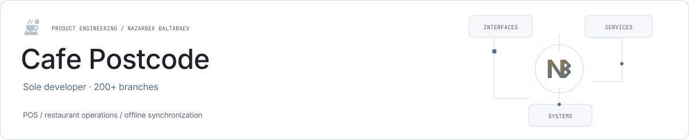
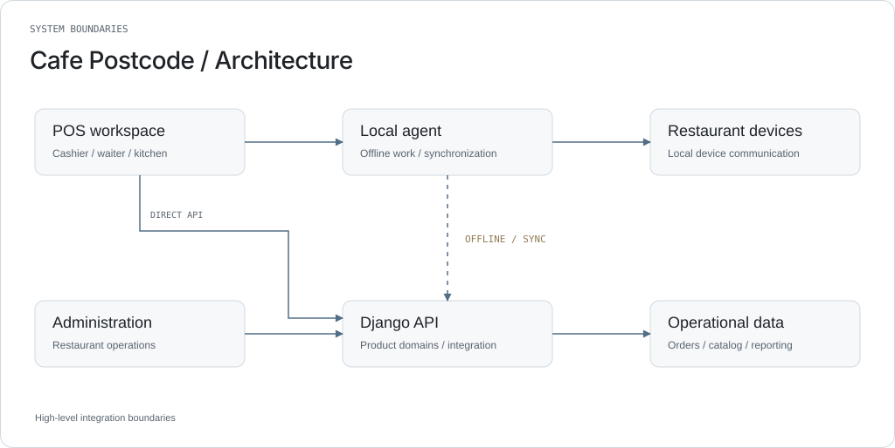

<picture><source media="(prefers-color-scheme: dark)" srcset="../assets/cafe-postcode-dark.svg"></picture>

# Cafe Postcode

**Restaurant operations, including the offline path.**

Cafe Postcode is a restaurant-management system covering POS, orders, kitchen workflows, menu and stock operations, staff, reporting and device integration. It was built end to end by Nazarbek Baltabaev and is used in more than 200 branches.

| Role | Stack |
| --- | --- |
| Sole developer | React · TypeScript · MUI · Django · Go |

## Application surfaces

The POS handles cashier work, while the administration interface supports operational configuration and management. Public repositories exist for the backend, POS and administration client.

## Backend boundaries

Django domain apps organize business data and workflows. Existing repository guides describe the API, service and data-access responsibilities and local development setup.

## Local integration

A separate local agent connects restaurant workstations and devices with the broader platform. The local-agent and synchronization path supports offline operations and later communication with the backend.

## Engineering concerns

Order lifecycles, financial calculations, device communication, retries and synchronization need consistent state boundaries across the interface, local processes and backend.

## Product scope

The 200+ branch figure is the maintainer’s operating count for the broader product; it is not a count of installations of an individual public repository.

## High-level architecture

<picture><source media="(prefers-color-scheme: dark)" srcset="../assets/cafe-postcode-architecture-dark.svg"></picture>

## Links

- [Product website](https://cafe-postcode.uz/)
- [Nazarbek Baltabaev](https://github.com/archon1999)

[← All projects](../README.md)
