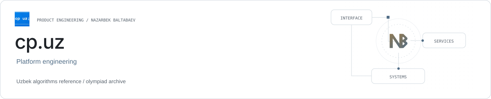

<picture><source media="(prefers-color-scheme: dark)" srcset="../assets/cp-uz-dark.svg"></picture>

# cp.uz

**An Uzbek competitive-programming knowledge platform.**

cp.uz organizes algorithms, learning paths and olympiad material for the Uzbek competitive-programming community.

| Role | Stack |
| --- | --- |
| Platform engineering | React · TypeScript · Django · Markdown |

## Knowledge structure

Algorithm references, study routes and olympiad archives provide a structured learning surface.

## Personal continuity

Saved notes, bookmarks and individual learning results connect browsing with continued study.

## Implementation

React and TypeScript provide the interface; Django services and Markdown support the knowledge platform.

## Links

- [Product website](https://cp.uz/)
- [Public source repository](https://github.com/cp-uz/cp-uz)
- [Nazarbek Baltabaev](https://github.com/archon1999)

[← All projects](../README.md)
