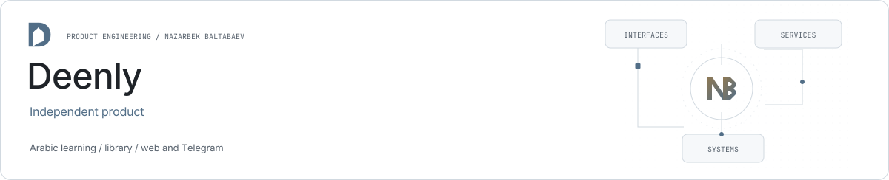

<picture><source media="(prefers-color-scheme: dark)" srcset="../assets/deenly-dark.svg"></picture>

# Deenly

**Learning continuity across web and Telegram.**

Deenly combines Arabic learning, a library, calendar and reminders across a React website and Telegram bot.

| Role | Stack |
| --- | --- |
| Independent product | React · TypeScript · MUI · Django · aiogram |

## Shared domain

The website and Telegram bot use common backend domain services and a shared learning profile.

## Interface

React, TypeScript and MUI support English, Uzbek and Russian interfaces, with separate Arabic typography.

## Backend

Django APIs, aiogram bot handlers and background work share the product’s data and progress model.

## Links

- [Product website](https://deenly.uz/)
- [Public source repository](https://github.com/archon1999/DeenlyBot)
- [Nazarbek Baltabaev](https://github.com/archon1999)

[← All projects](../README.md)
