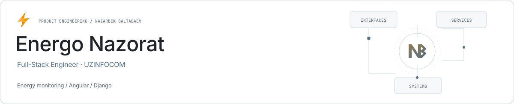

<picture><source media="(prefers-color-scheme: dark)" srcset="../assets/energo-nazorat-dark.svg"></picture>

# Energo Nazorat

**Energy monitoring across interface and services.**

Energo Nazorat covers energy and resource monitoring and reporting. Nazarbek worked as a Full-Stack Engineer at UZINFOCOM from January 2024 to December 2025.

| Role | Stack |
| --- | --- |
| Full-Stack Engineer · UZINFOCOM | Angular · TypeScript · Django · DRF |

## Interface

Angular screens support monitoring and operational reporting.

## Services

Django APIs, data models and integrations connect the interface to the product’s domain data.

## Delivery

Responsibilities covered analysis, implementation, release and corrections in an existing operational system.

## Links

- [Nazarbek Baltabaev](https://github.com/archon1999)

[← All projects](../README.md)
