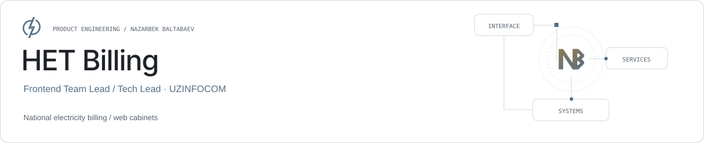

<picture><source media="(prefers-color-scheme: dark)" srcset="../assets/het-billing-dark.svg"></picture>

# HET Billing

**Shared frontend architecture for electricity billing.**

HET Billing is a national-scale electricity-billing system. At UZINFOCOM, Nazarbek worked as Frontend Team Lead / Tech Lead from May 2023 to August 2025, leading 10 frontend engineers across related applications.

| Role | Stack |
| --- | --- |
| Frontend Team Lead / Tech Lead · UZINFOCOM | Angular · TypeScript · RxJS · PrimeNG |

## Connected applications

The scope included billing, web cabinets, e-Dalolatnoma and HETK frontend work.

## Technical leadership

Responsibilities included frontend architecture, shared components, code review, API-integration conventions and release coordination.

## Interface demands

Operational tables, complex forms and cross-application consistency were central interface concerns.

## Links

- [Product website](https://cabinet.het.uz/)
- [Nazarbek Baltabaev](https://github.com/archon1999)

[← All projects](../README.md)
