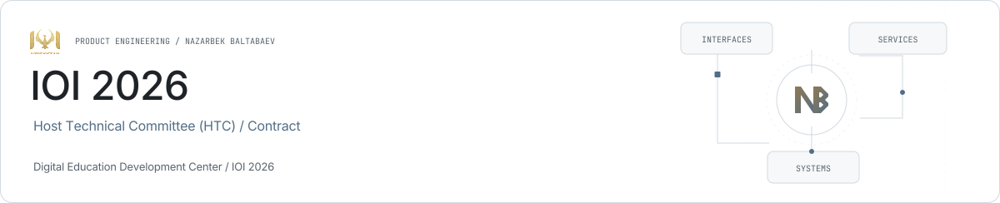

<picture><source media="(prefers-color-scheme: dark)" srcset="../assets/ioi-2026-dark.svg"></picture>

# IOI 2026

**Contestant environments and technical preparation.**

Member of the IOI 2026 Host Technical Committee (HTC), engaged by the Digital Education Development Center on a service contract. The center operates under Uzbekistan’s Ministry of Digital Technologies.

| Organization | Role | Period |
| --- | --- | --- |
| Digital Education Development Center | Host Technical Committee (HTC) member · Contract | 2026 |

**Technologies:** Linux · Python · Bash · GDB · VS Code.

## Environment preparation

Linux systems, virtual machines and reference images for contestant workstations.

## Debugging

GDB and VS Code debugging configuration and reliability work.

## Offline resources

Local resources and environment configuration for the event’s technical workflows.

## Technical operations

Software configuration and verification, competition server and network monitoring, and archiving submitted solutions and server configurations. Work within the local technical working group and alongside the international committee.

## Links

- [Product website](https://ioi2026.uz/)
- [Digital Education Development Center](https://edu.digital.uz/)
- [Portfolio case study](https://nazarbek.me/en/work/ioi-2026/)
- [Nazarbek Baltabaev](https://github.com/archon1999)

[← All projects](../README.md)
