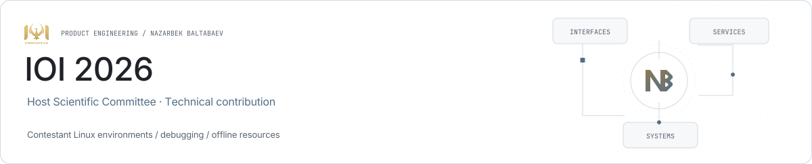

<picture><source media="(prefers-color-scheme: dark)" srcset="../assets/ioi-2026-dark.svg"></picture>

# IOI 2026

**Contestant environments and technical preparation.**

As a member of the IOI 2026 Host Scientific Committee, Nazarbek contributed to contestant environments and practical technical tooling.

| Role | Stack |
| --- | --- |
| Host Scientific Committee · Technical contribution | Linux · Python · Bash · GDB |

## Environment preparation

Linux systems, virtual machines and reference images for contestant workstations.

## Debugging

GDB and VS Code debugging configuration and reliability work.

## Offline resources

Local resources and environment configuration for the event’s technical workflows.

## Links

- [Product website](https://ioi2026.uz/)
- [Nazarbek Baltabaev](https://github.com/archon1999)

[← All projects](../README.md)
