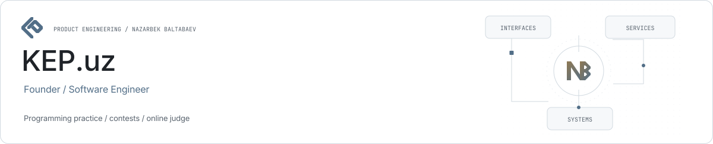
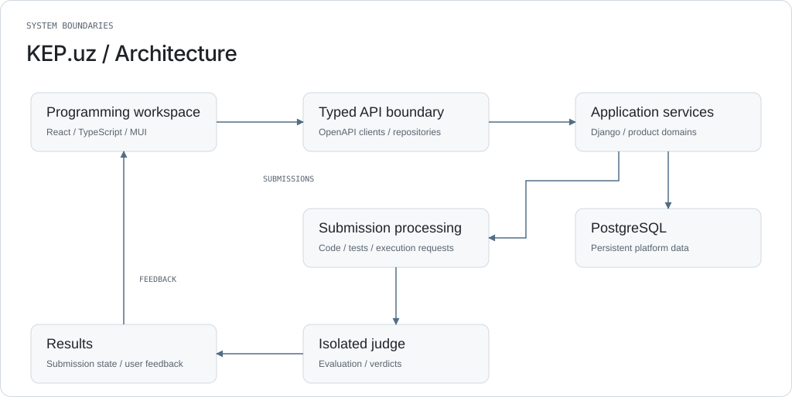

<picture><source media="(prefers-color-scheme: dark)" srcset="../assets/kep-dark.svg"></picture>

# KEP.uz

**Programming practice as a connected platform.**

KEP.uz connects problem solving, submissions, contests, duels, learning paths and community features. Nazarbek Baltabaev founded the platform and works across the product, frontend, backend and online-judge infrastructure.

| Role | Stack |
| --- | --- |
| Founder / Software Engineer | React · TypeScript · MUI · Django · PostgreSQL · Redis |

## Product surface

Problem and submission workspaces, contest flows, duels, learning and community experiences share a modular React application.

## Interface architecture

The public frontend separates app composition, product modules and shared infrastructure. Feature boundaries follow UI, application hooks, repository contracts, data-access implementations and DTO mapping.

## Typed integration

Generated OpenAPI clients connect the React workspace to backend APIs. Authentication, CSRF handling, localization and real-time updates are shared concerns.

## Judging path

Submissions pass through the backend to isolated code-evaluation infrastructure. Problems, tests and verdicts remain separate from the presentation layer.

## Operational scope

Public counters distinguish registered users, visible problems, contests and submitted solutions. They do not represent daily active users or accepted-solution totals.

## High-level architecture

<picture><source media="(prefers-color-scheme: dark)" srcset="../assets/kep-architecture-dark.svg"></picture>

## Public platform data

| Registered users | Visible problems | Contests | Submissions |
| ---: | ---: | ---: | ---: |
| 9,566 | 2,101 | 374 | 436,371 |

Observed **2026-10-29**, Asia/Tashkent. [Public API](https://kep.uz/api/landing-page-statistics) · [Snapshot data](../data/platform-snapshot.json).

## Community and olympiads

KEP.uz also provides a technical platform for organized competitions, including KEP Junior Algorithmics 2024 and REVO CUP 2025. [Event records and primary sources](../community/olympiads.md).

## Links

- [Product website](https://kep.uz/)
- [Public source repository](https://github.com/archon1999/kep-frontend)
- [Nazarbek Baltabaev](https://github.com/archon1999)

[← All projects](../README.md)
