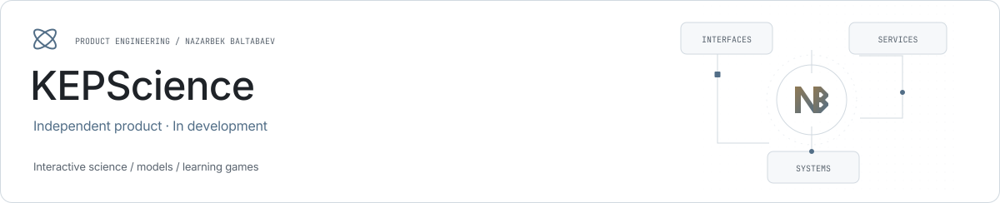

<picture><source media="(prefers-color-scheme: dark)" srcset="../assets/kepscience-dark.svg"></picture>

# KEPScience

**Interactive science as a learning product.**

| Role | Stack |
| --- | --- |
| Independent product | React · TypeScript · Django · DRF |

## Concepts

An atlas connects scientific terms and explanations.

## Interactive learning

Models and games provide a practical way to explore a concept and its assumptions.

## Development status

The platform is under development; its scope is presented as product work rather than a claim of a completed production rollout.

## Links

- [Product website](https://science.kep.uz/)
- [Nazarbek Baltabaev](https://github.com/archon1999)

[← All projects](../README.md)
