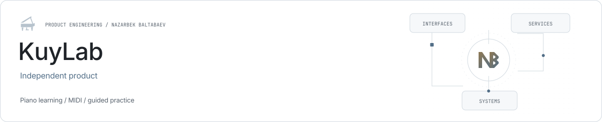

<picture><source media="(prefers-color-scheme: dark)" srcset="../assets/kuylab-dark.svg"></picture>

# KuyLab

**A piano-learning workspace.**

KuyLab combines piano practice, music theory and guided learning in one product. Its public repository contains the React frontend and Django backend.

| Role | Stack |
| --- | --- |
| Independent product | React · TypeScript · Django · MIDI · Web Audio |

## Practice interface

MIDI playback and visual score guidance connect musical material with interactive exercises.

## Learning continuity

Exercises and saved learning results support continued practice across sessions.

## Public implementation

The repository includes development instructions, frontend and backend code, delivery configuration and verification commands.

## Links

- [Product website](https://kuylab.uz/)
- [Public source repository](https://github.com/archon1999/kuylab)
- [Nazarbek Baltabaev](https://github.com/archon1999)

[← All projects](../README.md)
