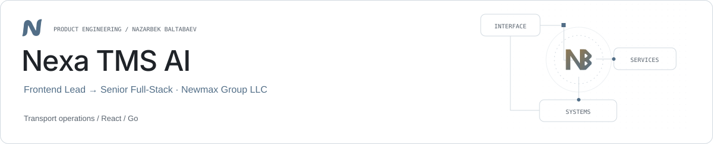

<picture><source media="(prefers-color-scheme: dark)" srcset="../assets/nexa-dark.svg"></picture>

# Nexa TMS AI

**From frontend leadership to full-stack product work.**

Nexa TMS AI, formerly ScaleTMS, is a transport-management product at Newmax Group LLC. Nazarbek began as Frontend Lead during the MVP and moved to Senior Full-Stack work after that stage.

| Role | Stack |
| --- | --- |
| Frontend Lead → Senior Full-Stack · Newmax Group LLC | React · TypeScript · Go · REST APIs |

## Operational domains

Dispatch, drivers, counterparties, trips, loads, maintenance, payroll and financial reporting.

## Frontend and services

Work spans React interfaces and Go services, including consistent operational data across reports and exports.

## Engineering focus

Assignment dates, monetary values and reporting boundaries need consistent treatment across product modules.

## Links

- [Product website](https://nexa-tms.ai/)
- [Nazarbek Baltabaev](https://github.com/archon1999)

[← All projects](../README.md)
