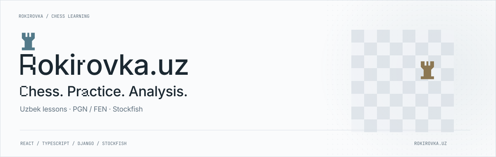

<picture><source media="(prefers-color-scheme: dark)" srcset="../assets/rokirovka-dark.svg"></picture>

# Rokirovka.uz

**Chess lessons, tactical practice and game analysis in Uzbek.**

An independently developed platform for lessons, guides, tactical puzzles, games, tournaments and the Uzbekistan chess archive.

| Responsibility | Technologies |
| --- | --- |
| Product architecture and full-stack development | React · TypeScript · MUI · Django REST · python-chess · Stockfish |

## Connected board workflows

The same board supports lessons, puzzle practice, play and analysis. PGN import/export, FEN positions, move replay and alternative continuations connect study to reviewing a game.

## Server authority and bounded analysis

Django validates legal moves and manages clocks, training results, races and tournament rounds. Stockfish uses UCI with limits on analysis time, concurrent processes, threads and memory.

## Learning and reference material

Uzbek lessons and spaced review sit alongside Lichess CC0 puzzles, player profiles and dated FIDE ratings. Repeatable imports and content snapshots preserve traceable sources.

[Website](https://rokirovka.uz/) · [Source](https://github.com/archon1999/rokirovka)

[← All projects](../README.md)
