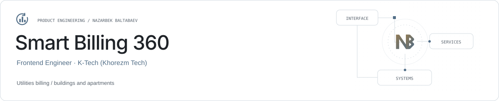

<picture><source media="(prefers-color-scheme: dark)" srcset="../assets/smart-billing-360-dark.svg"></picture>

# Smart Billing 360

**Utilities billing for buildings and apartments.**

Smart Billing 360 is the product; K-Tech (Khorezm Tech) is the company. Nazarbek worked as a Frontend Engineer from September 2024 to May 2025 on utilities-billing interfaces for Germany.

| Role | Stack |
| --- | --- |
| Frontend Engineer · K-Tech (Khorezm Tech) | Angular · TypeScript · REST APIs |

## Billing scope

Hot water, cold water and electricity across buildings and apartments.

## Frontend work

Angular forms, operational tables, backend API integration and dashboard navigation.

## Engineering focus

Clear entity boundaries and consistent interaction patterns across related billing workflows.

## Links

- [Nazarbek Baltabaev](https://github.com/archon1999)

[← All projects](../README.md)
